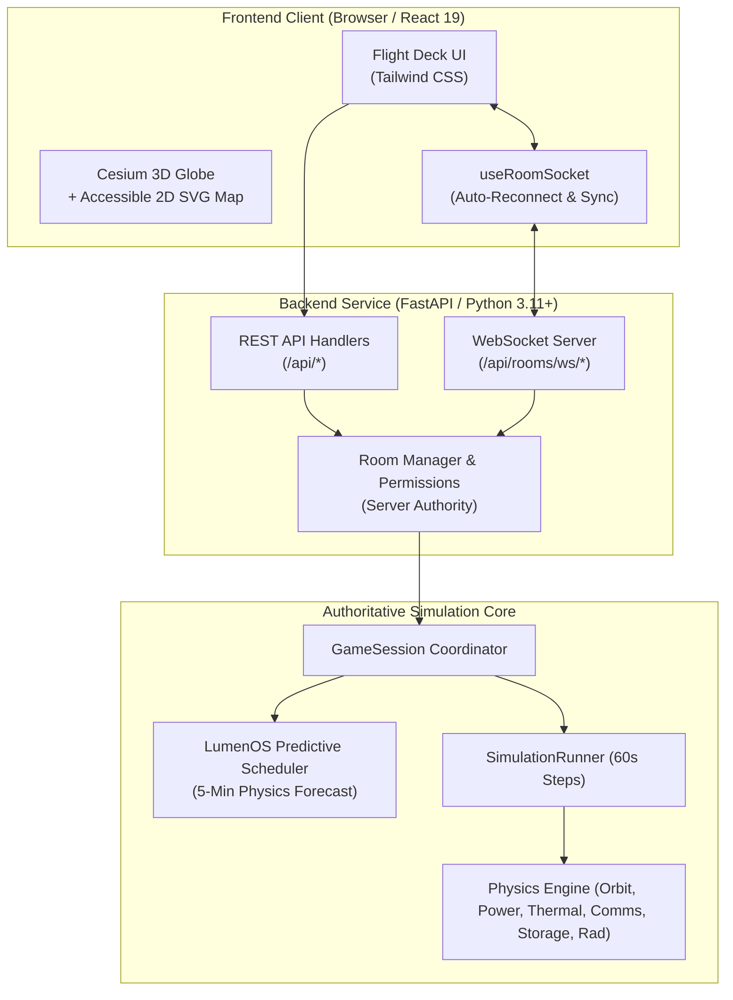

# LumenOS — Orbital Mission Architect

[](docs/testing.md)
[](docs/testing.md)
[](docs/validation.md)
[](LICENSE)

**LumenOS** is an educational, interactive space mission architecture and orbital simulation platform. It blends authentic aerospace engineering models—Keplerian astrodynamics, $J_2$ Earth oblateness drift, solar array degradation, lumped capacitance thermal radiation, RF link budgets, and solid-state data recorders—with high-stakes flight operations and predictive artificial intelligence.

Operate solo across an **All Stations** workspace, or join up to four players in **Cooperative Multiplayer** across four specialized space mission disciplines.

---

## 🚀 Key Features

- **Dual-Mode Flight Operations**:
  - **Solo Mode (All Stations)**: Control mission priorities, power balance, observation targets, and orbital maneuvers from a unified master console.
  - **Cooperative Multiplayer (2–4 Players)**: Private room codes (1.07B combos, zero-auth guest access), real-time WebSocket state broadcasting, dynamic role bundling, cross-role action approvals, and tactical crew pings.
- **Four Distinct Crew Roles**:
  - 🎖️ **Mission Director**: Budget allocation, high-risk overrides, payload prioritization, AI consultations.
  - 🔧 **Systems Engineer**: Power modes, battery reserve balancing, thermal radiator trimming, CPU profiles, survival heaters, emergency safe mode.
  - 🔬 **Science Officer**: Observation planning, optical/SAR collection, onboard compression, priority downlink scheduling.
  - 🚀 **Flight Controller**: Ground tracks, orbital maneuvers, attitude alignment (Sun-pointing, Earth-nadir, Low-Drag), ground station contacts.
- **Four Data-Driven Scenario Families**:
  - 🔥 **Wildfire Scout — Eyes on Fire**: Thermal infrared hotspots, smoke attenuation, rapid alert delivery across Southeastern Australia.
  - 🌊 **Flood Scout — Rising Waters**: SAR radar flood extent mapping, storage backlog management, downlink prioritization across the Brahmaputra & Ganges basins.
  - ☀️ **Solar Storm Sentinel — Watch the Sun**: Solar flare monitoring, coronal mass ejection tracking, space-weather radiation safe mode.
  - 🌋 **Volcano Watch — Fire Beneath the Earth**: Active volcano observation, $\text{SO}_2$ plume tracking, ash cloud collision hazard avoidance.
- **LumenOS Predictive Mission Management**:
  - Interpretable, physics-based 5-minute forward forecasting for bus temperature, battery SoC, storage saturation, and link loss.
  - Actionable recommendations and optional autopilot execution with an epistemic barrier (zero leakage of future stochastic events).
  - Standardized **Three-Way Benchmark Harness** (Manual Pilot vs Reactive Autopilot vs LumenOS Predictive Control).
- **Interactive 3D Cesium & 2D Accessible Flight Decks**:
  - CesiumJS 3D WGS-84 Earth viewer with orbital trajectories, sensor footprints, ground stations, and active RF link beams.
  - High-contrast 2D Equirectangular SVG map with full keyboard navigation and tabular screen-reader telemetry for accessibility and low-spec student laptops.
- **Post-Mission Analysis & What-If Studio**:
  - Explainable scoring with strict **Safety Cap** (bus loss or critical battery collapse caps score at 49 / Grade F).
  - Bit-exact deterministic **What-If simulation branching** with side-by-side telemetry overlays and causal analysis.
  - Persistent career progression, XP, rank titles, and modular hardware unlock store.
- **7 Bundled Offline NASA / Partner Datasets**:
  - NASA FIRMS, TSIS-1, CERES, DONKI, Copernicus Sentinel-1, TROPOMI, and NORAD TLE pre-packaged in [`data/offline/`](file:///d:/projects/LumenOS/data/offline/) for zero-credential offline operation.

---

## 🏛️ System Architecture



---

## 📖 Technical & Player Documentation

LumenOS includes comprehensive, peer-review grade documentation across all domains:

| Guide / Document | Focus Area |
|:---|:---|
| 🏗️ [**Architecture Guide**](docs/architecture.md) | Client/backend monorepo layout, server authority, session lifecycle, and dataflow diagrams. |
| 🎮 [**Game Design & Mechanics**](docs/game-design.md) | 9-stage game loop, 4 crew roles, difficulty settings, scoring engine, safety caps, and XP unlock store. |
| 👥 [**Multiplayer Specification**](docs/multiplayer.md) | Co-op room lifecycle, 2–4 player role bundling, WebSocket synchronization, tactical pings, and disconnect recovery. |
| 🛰️ [**Simulation Physics**](docs/simulation.md) | Astrodynamics, $J_2$ secular drift, solar generation, battery EFC wear, lumped thermal balance, FSPL, and SSDR queues. |
| 🗺️ [**Mission Scenarios**](docs/missions.md) | The 4 data-driven scenario families: stories, scientific contracts, orbital baselines, hazards, and rewards. |
| 🔭 [**NASA Data & Provenance**](docs/nasa-data.md) | 4-tier semantic provenance taxonomy, 11-field dataset audit, offline fallback bundles, and FIRMS disclaimer. |
| 🧠 [**Predictive AI & Autopilot**](docs/ai.md) | 5-minute forward forecasting, epistemic barrier, action recommendations, and the 3-Way Benchmark Harness. |
| 🔬 [**Scientific Validation**](docs/validation.md) | Governing equations, physical units, universal constants, GMAT R2022a numerical comparison tables, and Game Assumptions. |
| 🧪 [**Testing Strategy**](docs/testing.md) | Automated testing philosophy, module breakdown for all 480 backend and frontend tests, and execution guide. |
| ☁️ [**Deployment Guide**](docs/deployment.md) | Monorepo deployment on Vercel (frontend) and Render (backend + PostgreSQL), environment variables, and rollbacks. |
| 🛠️ [**Manual Setup Guide**](docs/manual-setup.md) | Step-by-step human guide: local installation, running dev servers, test execution, cloud deployment, and smoke testing. |

---

## ⚡ Quick Start (Local Setup)

### Prerequisites
- **Python**: 3.11+
- **Node.js**: 20+ (with npm 10+)
- **Git**

### Installation

```powershell
# 1. Clone repository
git clone https://github.com/your-username/LumenOS.git
cd LumenOS

# 2. Set up Python virtual environment
python -m venv .venv
.\.venv\Scripts\activate       # On macOS/Linux: source .venv/bin/activate
pip install -e ".[dev]"

# 3. Install frontend dependencies
cd apps/web
npm install
cd ../..
```

### Run Development Servers

```powershell
# Terminal 1: Backend API (port 8000)
.\.venv\Scripts\python.exe -m uvicorn api.main:app --reload --port 8000

# Terminal 2: Frontend (port 5173)
npm --prefix apps/web run dev
```

Open **`http://localhost:5173`** in your browser.

---

## 🧪 Running Automated Tests

LumenOS enforces a 100% automated test pass standard across both backend and frontend:

```powershell
# Run backend pytest suite (386 tests)
.\.venv\Scripts\python.exe -m pytest

# Run frontend Vitest suite (94 tests across 16 files)
npm --prefix apps/web test -- --run

# Run production build verification
npm --prefix apps/web run build
```

---

## ☁️ Deployment

- **Frontend (Vercel)**: Configured via [`vercel.json`](file:///d:/projects/LumenOS/vercel.json) with Vite framework preset, instant edge routing, and SPA rewrites.
- **Backend (Render)**: Configured via [`render.yaml`](file:///d:/projects/LumenOS/render.yaml) with Python web service, `/api/health` health checks, and managed PostgreSQL database.

See the complete [**Deployment Guide**](docs/deployment.md) and [**Manual Setup Guide**](docs/manual-setup.md) for full instructions.

---

## 📄 License & Attribution

LumenOS is released under the [MIT License](LICENSE).
Scientific data products are distributed under the NASA Open Data Policy, NOAA Open Data Policy, and Copernicus Open Access Policy.
