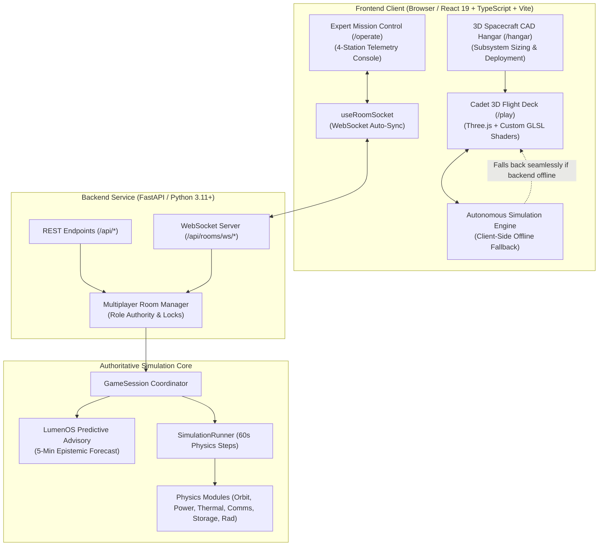

# LumenOS — Next-Generation Orbital AI Data Center & Space Academy

[](docs/testing.md)
[](docs/testing.md)
[](docs/validation.md)
[](apps/web/src/components/flight/)
[](LICENSE)

**LumenOS** is an interactive space mission architecture, orbital simulation game, and educational space academy. It bridges authentic aerospace engineering physics—Keplerian astrodynamics, $J_2$ Earth oblateness drift, Stefan-Boltzmann active thermal radiation rejection, solar array degradation, battery equivalent full cycle (EFC) wear, and RF/Optical inter-satellite link budgets—with next-generation **Orbital AI Data Center satellites**, photorealistic 3D Earth visualization, and multi-player flight operations.

Fly solo in an interactive 3D Low Earth Orbit flight deck, architect custom spacecraft in the 3D CAD hangar, or coordinate with up to four players in real-time **Cooperative Mission Control** across four specialized space mission disciplines.

---

## 🎯 Project Overview & Objectives

### 1. Project Mission
Space exploration and satellite operations are transitioning into an era of **in-orbit edge computing** and autonomous constellation networks. Modern spacecraft must handle terabytes of Earth-observation data in real time, run neural inference in orbit, dissipate massive thermal loads into the vacuum of space, and crosslink critical telemetry across laser meshes before traditional ground-station passes.

**LumenOS was built to make these sophisticated aerospace concepts intuitive, visually stunning, and rigorously authentic.**

### 2. Core Objectives
- **Authentic Astrodynamics & Spacecraft Physics**: Simulate real Low Earth Orbit (LEO) orbital mechanics with Sun-Synchronous Orbits (SSO), Keplerian great-circle propagation, eclipse duty cycles, lumped-capacitance thermal balance ($\dot{Q} = \epsilon \sigma A (T^4 - T_{\text{space}}^4)$), solar panel radiation degradation, and battery depth-of-discharge aging.
- **Orbital AI Data Center Constellation**: Design and deploy next-generation orbital AI computing infrastructure featuring heavy spacecraft buses, high-efficiency deployable thermal radiator wings, rotary sun-tracking solar arrays, 24-TOPS rad-hard neural inference hardware, and dynamic optical laser crosslinks (1550 nm ISL mesh).
- **Cinematic Environmental Disaster Response**: Model four real-world planetary monitoring theaters (Wildfire fronts, River basin floods, Plinian volcanic eruptions, and Extreme Solar Storm space-weather events) with custom procedural GLSL shaders, multi-spectral sensor footprints, and real NASA/NOAA offline datasets.
- **Dual Flight Modalities (Cadet vs. Expert)**:
  - **Cadet 3D Action Simulator (`/play`)**: 60 FPS real-time orbital flight deck with RCS attitude steering, nadir sensor locks, Edge AI neural inference, ISL optical downlinks, and Lumi the AI copilot.
  - **Expert Operations Console (`/operate`)**: 4-station mission control room with live engineering telemetry, predictive forward physics advisory, and WebSocket co-op synchronization.
- **Spacecraft CAD & Integration Hangar (`/hangar`)**: Interactive 3D spacecraft builder with real-time mass/power/thermal accounting, 5-stage mechanical deployment kinematics, and engineering verification reports.
- **Zero-Barrier Universal Access**: Full dual-execution architecture supporting both a high-concurrency Python FastAPI backend and a 100% autonomous client-side simulation engine for instant zero-dependency deployment on static hosts (e.g., Vercel).

---

## 🚀 Key Features

### 🛰️ Orbital AI Data Center Constellation
- **High-Performance Spacecraft Bus**: Heavy modular spacecraft bus engineered with titanium frames, graphite thermal panels, and enclosed 24-TOPS neuromorphic compute blades.
- **Deployable Thermal Radiator Wings**: Dual deployable radiators with parallel micro-channel heat pipes and active thermal louver articulation to reject compute heat in space.
- **Rotary Sun-Tracking Solar Arrays**: Photovoltaic GaAs panels that articulate around rotary yokes to track the sun while keeping radiators edge-on to deep space.
- **Optical Laser Crosslink Mesh (ISL)**: Dynamic inter-satellite laser communication links (1550 nm, up to 12 Gbps) connecting low-orbit scout satellites to high-orbit flagship mother stations (`LUMEN-DC-ALPHA`) and ground stations.
- **Autonomous Mechanical Deployment**: 5-stage animated deployment kinematics (bus unlatch $\rightarrow$ radiator wing extend $\rightarrow$ solar array unfold $\rightarrow$ gimbal dish deploy $\rightarrow$ optical crosslink lock).

### 🌍 Four Data-Driven Environmental Mission Theaters
1. 🔥 **Wildfire Scout — Eyes on Fire**
   - **Physics & Shaders**: Multi-layered procedural flames, wind-sheared volumetric smoke, glowing thermal embers, and Short-Wave Infrared (SWIR) thermal imaging.
   - **Objective**: Task nadir sensors, run onboard `FireNet SWIR v4.2` 25:1 GeoJSON perimeter compression, and alert incident commands across southeastern Australia.
2. 🌊 **Flood Scout — Rising Waters**
   - **Physics & Shaders**: Dynamic river basin inundation, terrain elevation flooding, specular water reflections, storm anvil clouds, and slanted monsoon rainfall.
   - **Objective**: Penetrate dense cloud cover with C-Band Synthetic Aperture Radar (SAR), execute 50:1 water-mask segmentation, and downlink crisis vectors.
3. 🌋 **Volcano Watch — Fire Beneath the Earth**
   - **Physics & Shaders**: Plinian tephra ejection columns, umbrella ash dispersion at the tropopause, and incandescent glowing lava flows transitioning to dark basalt rock.
   - **Objective**: Detect abnormal thermal calderas, track stratospheric $\text{SO}_2$ plumes with UV spectrometers, and issue ICAO aviation SIGMET warnings.
4. ☀️ **Solar Storm Sentinel — Watch the Sun**
   - **Physics & Shaders**: Coronal Mass Ejection (CME) interplanetary plasma waves, real-time dynamic Earth magnetosphere compression, and custom GLSL undulating polar auroral curtains (557.7 nm green to 630 nm violet).
   - **Objective**: Monitor extreme space-weather telemetry, survive solar proton flux spikes, and scrub single-event upsets (SEUs) in radiation-hardened memory.

### 🎮 Dual-Interface Gameplay Architecture
- **Cadet Flight Deck (`/play`)**:
  - Fullscreen 3D photorealistic Earth with atmospheric Rayleigh/Mie scattering, specular ocean lighting, city night lights, and cloud layers.
  - Interactive flight control: 3-axis keyboard RCS attitude steering (W/A/S/D), target intercept boost (Spacebar), and 5 camera perspectives (Scout Chase TPP, Nadir Scan, Cinematic Event Cam, AI Station, and Global Orbit).
  - 3-step tactile mission loop: **[E] Multi-Spectral Sensor Lock** $\rightarrow$ **[R] 24-TOPS Edge AI Inference** $\rightarrow$ **[F] Optical ISL Laser Downlink**.
  - High-dopamine tactical scoring, combo multipliers, sound effects, and Lumi AI robot companion tips.
- **Expert Operations Console (`/operate`)**:
  - 4-station mission control console (All Stations solo or co-op multiplayer).
  - Power subsystem balance (GaAs solar generation, battery Depth-of-Discharge, eclipse heaters).
  - Thermal subsystem regulation (Stefan-Boltzmann radiation rejection, active louvers).
  - RF & Optical comms management (free-space path loss, elevation masks, ground station AOS/LOS passes).
  - Storage & compute queue priority (priority alerts vs. raw science data).

### 👥 Cooperative Multiplayer (2–4 Players)
- **Zero-Auth Guest Rooms**: Instant 6-character room codes (1.07B combinations) with zero-credential login.
- **Four Operational Roles**:
  - 🎖️ **Mission Director**: Budget allocation, high-risk overrides, payload prioritization, AI consultations.
  - 🔧 **Systems Engineer**: Power modes, battery reserve balancing, thermal radiator trimming, CPU profiles, survival heaters, emergency safe mode.
  - 🔬 **Science Officer**: Observation planning, optical/SAR collection, onboard compression, priority downlink scheduling.
  - 🚀 **Flight Controller**: Ground tracks, orbital maneuvers, attitude alignment (Sun-pointing, Earth-nadir, Low-Drag), ground station contacts.
- **Real-Time Synchronization**: Authoritative FastAPI WebSocket state broadcasting, dynamic role bundling, cross-role action approvals, and tactical crew pings.

### 🧠 LumenOS Predictive Advisory Engine & Benchmark
- **5-Minute Forward Physics Forecasting**: Interpretable forward projection of battery State-of-Charge, bus temperatures, storage capacity, and link availability.
- **Strict Epistemic Barrier**: Forecasting models predict based solely on deterministic orbital physics and verified telemetry, strictly isolated from future stochastic events.
- **Three-Way Benchmark Harness**: Standardized performance comparisons evaluating **Manual Pilot** vs. **Reactive Autopilot** vs. **LumenOS Predictive AI**.

### 🔬 Scientific Validation & NASA Datasets
- **GMAT Verified Astrodynamics**: Numerical orbit propagation cross-checked against NASA Goddard Mission Analysis Tool (GMAT R2022a).
- **7 Bundled Offline Datasets**: Pre-packaged datasets in `data/offline/` (NASA FIRMS, TSIS-1, CERES, DONKI, Copernicus Sentinel-1, TROPOMI, NORAD TLE) for complete offline functionality without API keys.

---

## 🏛️ System Architecture



---

## 📖 Technical & Player Documentation

LumenOS includes peer-review grade documentation across all engineering and gameplay domains:

| Guide / Document | Focus Area |
|:---|:---|
| 🏗️ [**Architecture Guide**](docs/architecture.md) | Client/backend monorepo layout, server authority, session lifecycle, and dataflow diagrams. |
| 🎮 [**Game Design & Mechanics**](docs/game-design.md) | 9-stage game loop, 4 crew roles, difficulty settings, scoring engine, safety caps, and XP unlock store. |
| 👥 [**Multiplayer Specification**](docs/multiplayer.md) | Co-op room lifecycle, 2–4 player role bundling, WebSocket synchronization, tactical pings, and disconnect recovery. |
| 🛰️ [**Simulation Physics**](docs/simulation.md) | Astrodynamics, $J_2$ secular drift, solar generation, battery EFC wear, lumped thermal balance, FSPL, and SSDR queues. |
| 🗺️ [**Mission Scenarios**](docs/missions.md) | The 4 data-driven scenario families: stories, scientific contracts, orbital baselines, hazards, and rewards. |
| 🔭 [**NASA Data & Provenance**](docs/nasa-data.md) | 4-tier semantic provenance taxonomy, 11-field dataset audit, offline fallback bundles, and FIRMS disclaimer. |
| 🧠 [**Predictive AI & Autopilot**](docs/ai.md) | 5-minute forward forecasting, epistemic barrier, action recommendations, and the 3-Way Benchmark Harness. |
| 🔬 [**Scientific Validation**](docs/validation.md) | Governing equations, physical units, universal constants, GMAT R2022a numerical comparison tables, and Game Assumptions. |
| 🧪 [**Testing Strategy**](docs/testing.md) | Automated testing philosophy, module breakdown for all 502 backend and frontend tests, and execution guide. |
| ☁️ [**Deployment Guide**](docs/deployment.md) | Monorepo deployment on Vercel (frontend) and Render (backend + PostgreSQL), environment variables, and rollbacks. |
| 🛠️ [**Manual Setup Guide**](docs/manual-setup.md) | Step-by-step human guide: local installation, running dev servers, test execution, cloud deployment, and smoke testing. |

---

## ⚡ Quick Start (Local Setup)

### Prerequisites
- **Python**: 3.11+
- **Node.js**: 20+ (with npm 10+)
- **Git**

### Installation

```powershell
# 1. Clone the repository
git clone https://github.com/Alif-E7/LumenOS.git
cd LumenOS

# 2. Set up Python virtual environment
python -m venv .venv
.\.venv\Scripts\activate       # On macOS/Linux: source .venv/bin/activate
pip install -e ".[dev]"

# 3. Install frontend dependencies
npm --prefix apps/web install
```

### Run Development Servers

```powershell
# Terminal 1: Authoritative Backend API (port 8000)
.\.venv\Scripts\python.exe -m uvicorn api.main:app --reload --port 8000

# Terminal 2: Interactive 3D Web Frontend (port 5173)
npm --prefix apps/web run dev
```

Open **`http://localhost:5173`** in your browser.

> [!TIP]
> The web application includes an **autonomous client-side simulation engine**. Even if the Python backend is not running, the 3D cadet flight deck, spacecraft hangar, and mission simulation operate 100% offline.

---

## 🧪 Running Automated Tests

LumenOS enforces a strict 100% pass standard across **502 automated tests**:

```powershell
# 1. Run backend pytest suite (390 tests)
.\.venv\Scripts\python.exe -m pytest

# 2. Run frontend Vitest suite (112 tests across 19 files)
npm --prefix apps/web test

# 3. Verify production bundle build
npm --prefix apps/web run build
```

---

## ☁️ Deployment

- **Frontend (Vercel)**: Automatically configured via [`vercel.json`](file:///d:/projects/LumenOS/vercel.json) with Vite framework preset and single-page application routing.
- **Backend (Render / Container)**: Configured via [`render.yaml`](file:///d:/projects/LumenOS/render.yaml) for FastAPI with `/api/health` health monitoring and managed PostgreSQL.

---

## 📄 License & Attribution

LumenOS is released under the [MIT License](LICENSE).  
Scientific Earth-observation data products are distributed under the NASA Open Data Policy, NOAA Open Data Policy, and Copernicus Open Access Policy.
