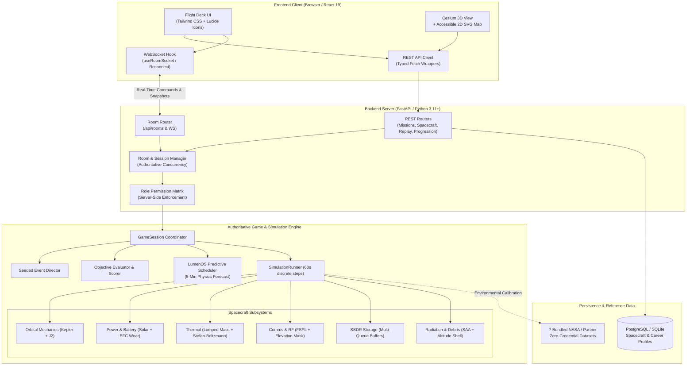
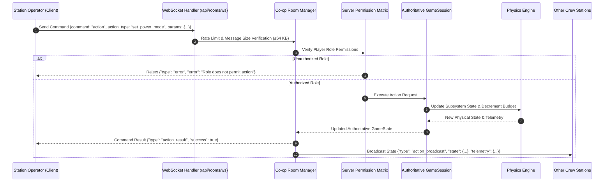

# LumenOS System Architecture

LumenOS is an educational, interactive space mission design and simulation platform. It operates as a unified monorepo featuring a high-performance **React 19 / TypeScript / Vite** frontend and an authoritative **Python / FastAPI** backend hosting a deterministic orbital and spacecraft subsystems simulation engine.

---

## 1. High-Level System Architecture

LumenOS maintains strict server-side authority. The client renders the mission control deck, flight instruments, and CesiumJS 3D visualizer, while all orbital state transitions, subsystem physics integrations, event triggers, and crew permissions are computed authoritatively on the backend.

---

## 2. Session Authority & Multiplayer Command Flow

Every mission session runs as an isolated, stateful `GameSession` managed by `SessionManager` and coordinated through `RoomManager`. Whether operating in **Solo Mode (All Stations)** or **Cooperative Multiplayer (2–4 Players)**, the command execution pipeline guarantees bit-exact determinism and server-authoritative integrity:

---

## 3. Technology Stack Summary

| Layer | Component | Technology | Rationale |
|:---|:---|:---|:---|
| **Frontend** | Framework & Bundler | React 19, TypeScript, Vite 8 | Ultra-fast HMR, strict type safety, zero-bundle overhead. |
| | Styling & UI | Tailwind CSS v4, Lucide Icons | Clean mission-control aesthetics, responsive grid, accessible contrast. |
| | 3D Visualization | CesiumJS (via `vite-plugin-cesium`) | High-precision WGS-84 globe, satellite orbits, ground tracks, sensor swaths. |
| | Accessible 2D Fallback | Equirectangular SVG Map & Tables | Works without WebGL, screen-reader friendly, accessible tabular telemetry. |
| **Backend** | API Framework | FastAPI (ASGI), Uvicorn | Native async WebSockets, automatic OpenAPI docs, high concurrency. |
| | Data Validation | Pydantic v2 | High-speed C-extension schema validation, strict type coercion. |
| | Persistence | SQLAlchemy 2.0 (Async), SQLite / PostgreSQL | Zero-config SQLite for local dev; async PostgreSQL for production hosting. |
| **Simulation** | Physics Engine | Pure Python 3.11+, NumPy, SciPy | Deterministic 60-second discrete step numerical integration. |
| | Astrodynamics | Analytical Kepler + $J_2$ Oblateness | Verified against NASA GMAT R2022a and Vallado orbital equations. |
| | Predictive AI | Rule-based & Physical forward forecasting | Transparent 5-minute thermal, power, and storage horizon predictions. |

---

## 4. Dual Operational Modes

1. **Solo Mode (All Stations Workspace)**:
   - The solo player commands all four spacecraft disciplines simultaneously via a unified workstation.
   - Restful step control allows forward stepping, pausing, speed modification, and timeline scrubbing.
2. **Co-op Multiplayer (2–4 Players)**:
   - Players join private rooms via 6-character high-entropy codes.
   - Dedicated stations: **Mission Director**, **Systems Engineer**, **Science Officer**, and **Flight Controller**.
   - Dynamic role bundling automatically maps 4 roles across 2 or 3 players.
   - Cross-role action requests, host start/pause/restart controls, and real-time synchronization.

