# LumenOS Game Design & Mechanics

LumenOS merges authentic aerospace engineering principles with engaging, accessible mission operations gameplay. Players balance spacecraft resources—electrical power, thermal limits, processor workload, propellant, and solid-state storage—while responding to environmental hazards and fulfilling scientific contracts.

---

## 1. The Core Mission Loop

Every mission follows a structured 9-stage progression:

```mermaid
flowchart LR
    A["1. Mode Select<br/>(Solo / Co-op)"] --> B["2. Contract Selection<br/>(4 Scenarios)"]
    B --> C["3. Spacecraft Design<br/>(Subsystem Tradeoffs)"]
    C --> D["4. Pre-Launch Review<br/>(GO / NO-GO Gates)"]
    D --> E["5. Launch & Injection<br/>(Orbit Placement)"]
    E --> F["6. Flight Deck Operations<br/>(Telemetry & Decisions)"]
    F --> G["7. Mission Outcome<br/>(Win / Partial / Loss)"]
    G --> H["8. Scoring & Rewards<br/>(XP & Tech Unlocks)"]
    H --> I["9. Replay & What-If<br/>(Trajectory Branching)"]
```

---

## 2. The Four Crew Disciplines & Role Stations

In Co-op multiplayer (or toggled in Solo All Stations), crew responsibilities are divided across four disciplines:

| Discipline | Station Name | Primary Responsibilities | Unique Actions |
|:---|:---|:---|:---|
| **Mission Director** | `Command Station` | Mission budget allocation, payload priorities, approving high-risk overrides, and consulting LumenOS AI predictions. | `allocate_budget`, `set_priority`, `respond_to_event`, `request_ai_prediction` |
| **Systems Engineer** | `Systems Station` | Electrical power balancing, battery charge management, thermal radiator trimming, CPU workload profiles, survival heaters, and emergency safe mode. | `set_power_mode`, `adjust_thermal`, `enter_safe_mode`, `reduce_workload`, `repair_subsystem` |
| **Science Officer** | `Science Station` | Observation target planning, instrument payload mode selection, optical/SAR data collection, onboard compression, and downlink queue prioritization. | `collect_data`, `schedule_observation`, `downlink_data`, `adjust_observation_plan` |
| **Flight Controller** | `Flight Station` | Ground track monitoring, orbit adjustments, attitude alignment (Sun-pointing, Earth-nadir, or Low-Drag), ground station pass acquisition, and thruster burns. | `adjust_orbit`, `fire_thruster`, `set_attitude`, `use_later_pass` |

---

## 3. Difficulty Settings

LumenOS features three difficulty profiles that scale environmental severity, operational budgets, and scoring multipliers:

| Difficulty Setting | Starting Budget | Event Frequency | Sensor Noise & Cloud Attenuation | Multiplier | Educational Focus |
|:---|:---|:---|:---|:---:|:---|
| **Cadet** | 12,000 cr | Low | Minimal | $1.0\times$ | Introduction to orbital mechanics and basic power balancing. |
| **Nominal** | 10,000 cr | Moderate | Standard empirical levels | $1.5\times$ | Balanced engineering tradeoffs and coordination. |
| **Hardcore** | 8,000 cr | High | Severe smoke/cloud and space weather | $2.0\times$ | High-stress triage, strict safety margins, and predictive planning. |

---

## 4. Explainable Scoring Engine

Missions are evaluated across four weighted scoring dimensions ($0–100\text{ points}$ total) plus an unyielding **Safety Cap**:

1. **Mission Objectives & Science Return** ($40\%$): Completion of primary and optional observation targets.
2. **Safety & Subsystem Reliability** ($25\%$): Battery depth of discharge preservation, thermal stability, and avoidance of catastrophic shutdown.
3. **Resource Efficiency** ($20\%$): Net budget remaining, propellant conservation, and minimal hardware wear.
4. **Communication & Data Delivery** ($15\%$): Successful downlink of calibrated science products and critical hazard alerts within observation deadlines.

### The Critical Safety Cap Rule
> [!CAUTION]
> If a mission suffers a critical safety violation (e.g. battery collapse $<10\%$, thermal runaway $>+65^\circ\text{C}$, or bus structural failure), the total mission score is **strictly capped at a maximum of 49 points (Grade F / NO-GO)**, regardless of scientific data collected. High science volume never excuses the loss of the spacecraft bus.

### Letter Grades & Star Ratings
- **⭐⭐⭐ Distinction (Grade A)**: Score $\ge 85$
- **⭐⭐ Commended (Grade B)**: Score $70–84$
- **⭐ Qualified (Grade C)**: Score $55–69$
- **Pass (Grade D)**: Score $50–54$
- **Mission Failure (Grade F)**: Score $<50$ (or Safety Cap violation)

---

## 5. Player Progression, XP & Module Unlocks

Post-mission achievements award **Experience Points (XP)** and **Engineering Credits**:
- **Player Leveling**: XP unlocks higher rank titles (Cadet Operator $\to$ Flight Controller $\to$ Mission Commander).
- **Engineering Credits**: Currency earned through mission efficiency to purchase advanced spacecraft hardware in the Unlock Store.
- **Unlockable Hardware Modules**:
  1. *Deployable GaAs Solar Wings* (Enhanced surface area & power generation)
  2. *Solid-State LFP High-Density Battery* (Higher usable DoD & cycle life)
  3. *LumenOS Neural Predictor Co-Processor* (Reduced CPU thermal draw)
  4. *Active Deployable Radiator Panels* (Enhanced deep-space heat rejection)
  5. *High-Gain Ka-Band Phased Array Antenna* (High-speed multi-station downlink)
  6. *Whipple Meteoroid & Debris Bumper* (Structural impact shielding)

