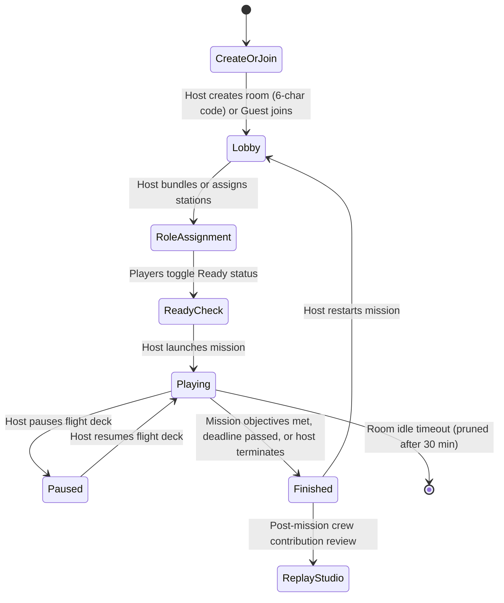

# LumenOS Cooperative Multiplayer

LumenOS features a real-time, 2-to-4 player cooperative multiplayer system. Rather than providing a spectator dashboard, every player operates a dedicated workstation with actions that directly alter the shared spacecraft state.

---

## 1. Room Lifecycle & Guest Access

Multiplayer operates entirely with guest display names and private, high-entropy room codes—requiring **no account creation, passwords, or OAuth barriers** for students and competition judges:

### High-Entropy Room Codes
Room codes are 6 characters generated from an unambiguous 32-character alphabet (`23456789ABCDEFGHJKLMNPQRSTUVWXYZ`), eliminating visual confusion between `0` and `O` or `1` and `I`. The keyspace of $1.07\text{ billion}$ combinations prevents room-guessing or collision.

---

## 2. Dynamic Role Bundling (2–4 Players)

LumenOS adapts seamlessly to any crew size from 2 to 4 players by dynamically bundling roles:

| Crew Size | Player 1 (Host) | Player 2 | Player 3 | Player 4 |
|:---:|:---|:---|:---|:---|
| **4 Players** | Mission Director | Systems Engineer | Science Officer | Flight Controller |
| **3 Players** | Mission Director | Systems Engineer | Science Officer + Flight Controller | — |
| **2 Players** | Mission Director + Flight Controller | Systems Engineer + Science Officer | — | — |

The room host retains the authority to dynamically reassign stations at any point prior to launch or mid-mission via the Crew Roster panel.

---

## 3. Real-Time WebSocket Synchronization

Clients connect to `/api/rooms/ws/{room_code}/{player_id}`. The WebSocket protocol manages:
- **State Broadcasting**: When any station executes an action or advances the simulation clock, an authoritative state update is broadcast simultaneously to all connected crew members.
- **Cross-Role Coordination Requests**:
  - A *Science Officer* needing emergency antenna power creates an `ActionRequest` targeted at the *Systems Engineer*.
  - The request appears in the target engineer's desk with an audio/visual cue, allowing one-click **Approval** or **Rejection**.
  - Requests automatically time out after 30 seconds if unattended, avoiding deadlock.
- **Tactical Coordination Pings**: Crew members broadcast rapid tactical pings (`ATTENTION`, `CONFIRM`, `URGENT`, `STANDBY`) accompanied by custom messages to coordinate through solar flares, eclipses, or ground station acquisition passes.

---

## 4. Fault Tolerance & Disconnect Recovery

1. **Holding Station Slots**: When a player experiences a network drop or closes their browser tab, their station slot is preserved (`connected = false`). The simulation continues unhindered.
2. **Exponential Backoff Reconnect**: The frontend automatically retries connection up to 5 times (1s, 2s, 4s, 8s).
3. **Full Snapshot Restoration**: Upon reconnection, the backend transmits a comprehensive `reconnect_state` message containing current mission MET, physical telemetry, active hazards, pending approvals, and the shared activity feed.
4. **Stale Room Pruning**: Abandoned rooms with no active connections or commands for over 30 minutes are automatically pruned by `room_manager.cleanup_stale_rooms()` to prevent server memory leaks.

